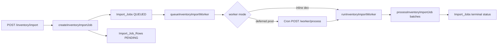

# Background Inventory Import Worker (Phase 5.6)

Asynchronous inventory CSV import for Baylen hybrid commerce. Builds on Phase 5.2 inventory rules with a queued worker suitable for Advanced I/O functions.

## Job states

| Status | Meaning |
|--------|---------|
| `QUEUED` | Job created; rows stored in `Import_Job_Rows`; waiting for worker |
| `PROCESSING` | Worker holds the job lock and is applying stock in batches |
| `COMPLETED` | All rows processed successfully |
| `COMPLETED_WITH_ERRORS` | Some rows succeeded, some failed |
| `FAILED` | No rows succeeded (all failed) |
| `CANCELLED` | Admin cancelled while `QUEUED` or `PROCESSING` |

## Tracked fields

Each job exposes:

- `job_id` / `id`
- `created_by` (`uploaded_by`)
- `filename`
- `total_rows`
- `processed_rows`
- `successful_rows` (`created_rows + updated_rows`)
- `failed_rows`
- `status`
- `started_at`
- `completed_at`
- `error_count`

## Phase 5.2 rules preserved

- Strict warehouse resolution (no HQ fallback)
- Absolute stock via `setAbsoluteStock`
- `STOCK_COUNT` movements with `reference_type = IMPORT`, `reference_id = job_id`
- Retry-safe: only `PENDING` / `FAILED` rows are reprocessed
- Idempotent re-import of identical stock quantities

## Architecture



Rows are fetched in batches (`LIMIT batchSize`) from `Import_Job_Rows` — the worker never loads the full CSV into memory after job creation.

## Admin API

Header: `x-baylen-admin-key: <ADMIN_API_KEY>`

| Method | Endpoint | Purpose |
|--------|----------|---------|
| `POST` | `/v1/admin/inventory/import` | Create job (`confirm=true`). **`async=true` by default** — returns `job_id` immediately |
| `GET` | `/v1/admin/inventory/import/:id` | Poll job status |
| `POST` | `/v1/admin/inventory/import/:id/process` | Manually start/queue processing |
| `POST` | `/v1/admin/inventory/import/:id/cancel` | Cancel (`QUEUED` or `PROCESSING` only) |
| `POST` | `/v1/admin/inventory/import/:id/retry` | Re-queue failed rows (`COMPLETED_WITH_ERRORS`, `FAILED`, `CANCELLED`) |
| `POST` | `/v1/admin/inventory/import/worker/process` | Process next queued jobs (Production Cron target) |

Job errors: `GET /v1/admin/imports/:id/errors?format=csv`

### Async import (default)

```json
POST /v1/admin/inventory/import
{
  "csv_text": "warehouse_code,sku,stock\nWH-RNC-001,MIN-NIA10-30ML,25\n",
  "filename": "inventory-rnc.csv",
  "confirm": true,
  "async": true
}
```

Response:

```json
{
  "job_id": "12345",
  "status": "QUEUED",
  "async": true,
  "worker_mode": "deferred",
  "message": "Inventory import queued — invoke POST /v1/admin/inventory/import/worker/process (Cron) to process"
}
```

### Synchronous import

Pass `"async": false` to block until processing completes (same behavior as Phase 5.2).

### Poll status

```json
GET /v1/admin/inventory/import/12345
```

### Cancel

```json
POST /v1/admin/inventory/import/12345/cancel
```

### Retry failed rows

```json
POST /v1/admin/inventory/import/12345/retry
```

## Concurrency and locking

- **Distributed lock** via Catalyst Cache (`import:job:lock:<job_id>`, TTL 15 min) — cross-instance safe in Production
- In-process fallback (`LOCAL_LOCKS`) when Cache unavailable or in unit tests
- `processInventoryImportJob` rejects if job status is already `PROCESSING` (409)
- Cancel sets `CANCELLED`; the batch loop checks status between batches and stops

## Worker modes

| Mode | When | Behavior |
|------|------|----------|
| `inline` | Development default | Process job in same HTTP request |
| `deferred` | Production default (`BAYLEN_ENV=production`) | Job stays `QUEUED` until Cron calls `/worker/process` |

Set `INVENTORY_IMPORT_WORKER_MODE=inline|deferred` to override.

## Audit

Create, process, cancel, and retry actions write to `Audit_Logs` via `writeAdminAudit` (`entity_type = IMPORT_JOB`).

## Related docs

- [INVENTORY_IMPORT.md](../catalog-import/INVENTORY_IMPORT.md) — CSV contract (Phase 5.2)
- [INVENTORY_IDENTITY.md](../catalog-import/INVENTORY_IDENTITY.md) — warehouse + SKU identity
